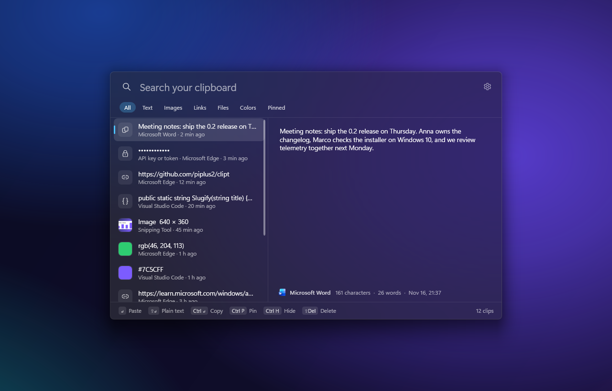
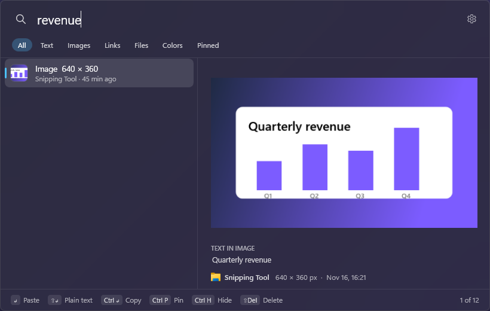
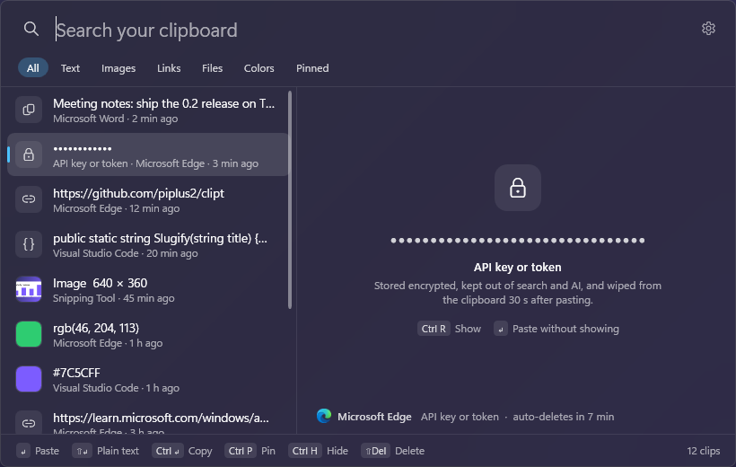
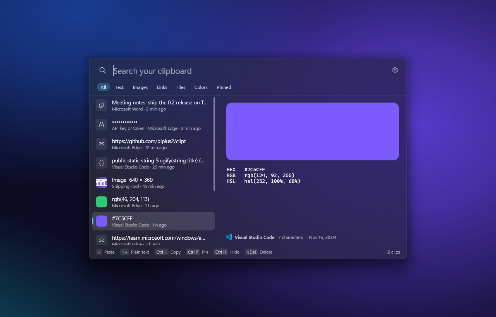

# Clipt

[](https://github.com/piplus2/clipt/releases/latest)
[](https://github.com/piplus2/clipt/releases)
[](LICENSE)
[](#windows)
[](#linux)
[](https://dotnet.microsoft.com/download/dotnet/10.0)

**A Spotlight-style clipboard history for Windows and Linux.** Press a shortcut, type a few letters, hit Enter, and it's pasted.



- **Everything you copy:** text, rich text, links, code, colours, images and files, with a live preview.
- **Instant search:** search ignores case and accents, matches are highlighted, and filters let you narrow by type
  or by app (`app:chrome`). **Text inside screenshots is searchable** too, thanks to the OCR built into Windows.
- **Feels native:** Windows 11 acrylic, your accent colour, light/dark mode, multi-monitor and per-monitor DPI,
  tray icon, starts with Windows, and can even take over **Win+V**.
- **Pastes where you were:** Enter closes Clipt and pastes into the app you were using. Shift+Enter pastes plain text.
- **Secure by design:** your history is encrypted, and passwords and keys are recognised and hidden automatically. [Details below](#security--privacy).
- **Optional AI:** press Tab on a clip to summarize, rewrite, translate, explain or ask anything, with Claude or a
  local model via Ollama. Off until you turn it on.

| Search text inside screenshots | Secrets are hidden automatically | Colour previews |
|---|---|---|
|  |  |  |

## Install

**[⬇ Download the latest release](https://github.com/piplus2/clipt/releases/latest)**

### Windows

1. Download **`Clipt-<version>-win-x64.exe`**. It's a single file with nothing else to install.
   If you already have the [.NET 10 Desktop Runtime](https://dotnet.microsoft.com/download/dotnet/10.0),
   the smaller `-framework-dependent` file works too.
2. Put it wherever you like (e.g. `%LOCALAPPDATA%\Programs\Clipt\`) and run it.
3. Press **Alt+Shift+V** anywhere.

Clipt runs on Windows 10 2004+; Windows 11 22H2+ gives the full look.

> **"Windows protected your PC"?** The exe isn't code-signed yet, so SmartScreen warns about new downloads.
> Click **More info → Run anyway**. You can check the file against `SHA256SUMS.txt` from the release
> with `Get-FileHash .\Clipt-*.exe`.

### Linux

Clipt runs on X11 desktops (GNOME, KDE Plasma, Xfce, Cinnamon, MATE…) and in Wayland sessions through XWayland,
with reduced features there (see below).

1. Download **`Clipt-<version>-linux-x64`**, make it executable (`chmod +x`) and run it.
2. Press **Alt+Shift+V** anywhere.

Optional extras:
- **Text in screenshots:** install Tesseract (`sudo apt install tesseract-ocr`, plus e.g. `tesseract-ocr-ita` for more
  languages).
- **Tray icon on GNOME:** needs the AppIndicator extension (built into Ubuntu).

The encryption key is kept in your desktop keyring (GNOME Keyring, KWallet, KeePassXC…). Without one, it's kept in a
file only your account can read.

> **Wayland:** Wayland doesn't let apps watch the clipboard, register global shortcuts or type into other windows,
> so under XWayland Clipt works only partly: the shortcut and paste-back reach X11 apps only, and capture depends on
> how your compositor shares the clipboard with XWayland. For the full experience log in with an X11 session
> ("GNOME on Xorg", "Plasma (X11)"). Only X11 has been tested so far.

### Build from source

Requires the .NET 10 SDK.

**Linux:** see [Building on Linux](docs/development.md#building-on-linux) for the full steps (dependencies,
SDK, build, install). In short:

```sh
git clone https://github.com/piplus2/clipt.git
cd clipt
git checkout linux-port
dotnet publish Clipt.csproj -c Release -f net10.0 -r linux-x64 --self-contained true -p:PublishSingleFile=true -o publish
./publish/Clipt
```

**Windows:**

```powershell
git clone https://github.com/piplus2/clipt.git
cd clipt
dotnet publish Clipt.csproj -c Release -f net10.0-windows10.0.22621.0 -r win-x64 --self-contained false -p:PublishSingleFile=true -o publish
.\publish\Clipt.exe
```

## Everyday use

| Keys | Action |
|---|---|
| **Alt+Shift+V** | Open / close Clipt (configurable; optionally Win+V) |
| type | Search |
| **Enter** · **Shift+Enter** · **Ctrl+Enter** | Paste · paste plain text · copy only |
| **Alt+1…9** | Paste the Nth clip |
| **Ctrl+P** | Pin (pinned clips are kept forever) |
| **Ctrl+H** · **Ctrl+R** | Mark as sensitive · show a hidden secret |
| **Shift+Del** | Delete |
| **Tab** | AI actions |
| **Ctrl+,** | Settings |

The full list and every setting are in the **[user guide](docs/user-guide.md)**.

## Security & privacy

A clipboard manager sees your passwords, so Clipt treats every clip as potentially sensitive:

- **Encrypted at rest:**
  - Everything copied is encrypted with AES-256-GCM, including images, text found in images and the source app.
  - The key is locked to your user account: with DPAPI on Windows, with the desktop keyring on Linux.
  - There's no plaintext search index, and deleted clips are overwritten.
- **Secrets detected automatically:** passwords, API keys and tokens, private keys, card numbers and IBANs are:
  - masked and kept out of search and AI
  - deleted after 10 minutes
  - marked private when pasted, so Windows clipboard history and other clipboard managers skip them, and wiped
    from the clipboard 30 s later
- **Not recorded:**
  - password-manager copies marked private
  - apps you exclude, picked by name and icon
  - private browsing windows
- **Invisible to screen sharing (Windows):** Clipt doesn't show up in screen shares, recordings or screenshots.
  Linux has no equivalent.

Read the full **[security design and threat model](docs/security.md)**. Report vulnerabilities privately as described in
[SECURITY.md](SECURITY.md).

## Documentation

| | |
|---|---|
| [User guide](docs/user-guide.md) | Using Clipt, settings, shortcuts, troubleshooting |
| [Security & privacy](docs/security.md) | Threat model, cryptography, secret handling, tests |
| [Architecture](docs/architecture.md) | Components, capture pipeline, storage, threading |
| [Development](docs/development.md) | Building, testing, conventions, release checklist |
| [Changelog](CHANGELOG.md) | What's new |

## Development

```sh
dotnet build
dotnet test tests/Clipt.Tests
CLIPT_DATA_DIR=/tmp/clipt-dev dotnet run -f net10.0                         # Linux: isolated history, no autostart
$env:CLIPT_DATA_DIR="$env:TEMP\clipt-dev"; dotnet run -f net10.0-windows10.0.22621.0   # Windows (PowerShell)
```

See the [development guide](docs/development.md).

## License

[MIT](LICENSE) © 2026 Paolo Inglese
