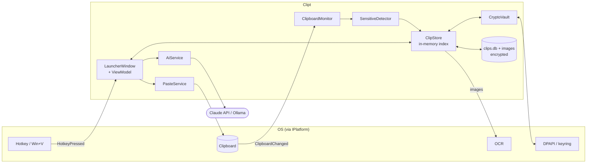
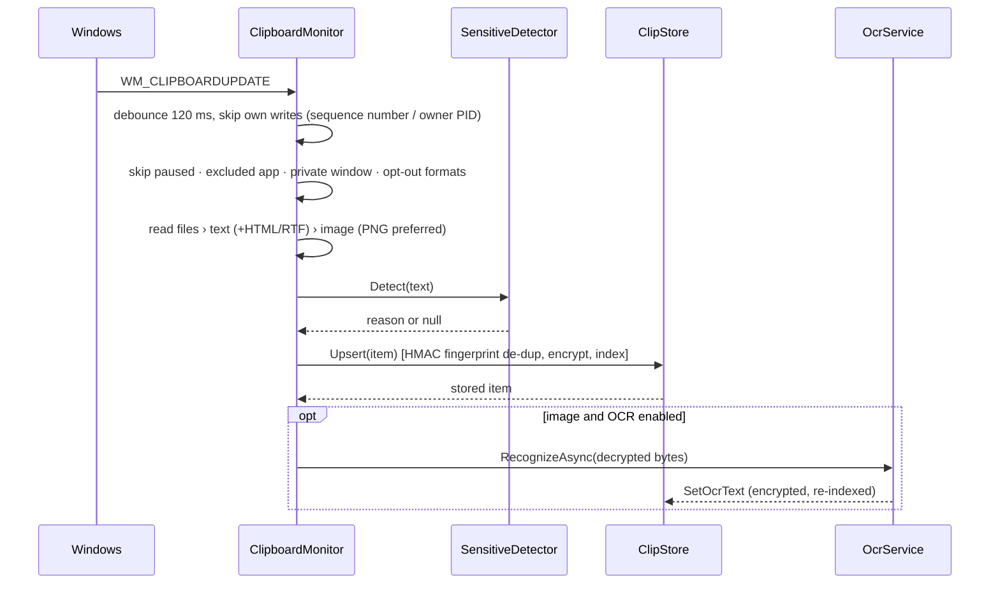
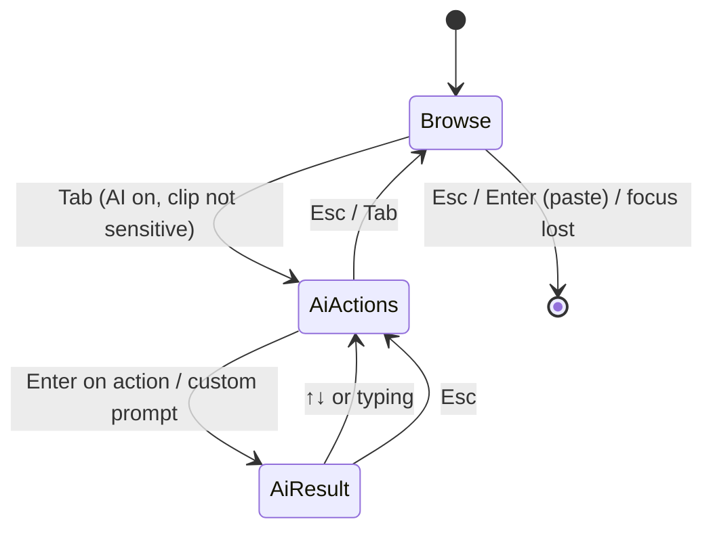

# Architecture

Clipt is a single-process Avalonia app (.NET 10) built from one codebase for two targets:

| Target | OS | Platform layer |
|---|---|---|
| `net10.0-windows10.0.22621.0` | Windows 10/11 | `Platform/Windows`: Win32 interop, WinForms clipboard and tray, WinRT OCR and accent colour, DPAPI |
| `net10.0` | Linux (X11) | `Platform/Linux`: Xlib/XFixes/XTest/XRes, Secret Service (libsecret), Tesseract, StatusNotifierItem tray |

The UI, storage, search, crypto, secret detection and AI are shared. Everything that differs between the OSes sits
behind one interface, `IPlatform` (`Platform/IPlatform.cs`). Each build compiles only its own platform folder.

## Components

| Component | File | Responsibility |
|---|---|---|
| `App` | `App.axaml.cs` | Start-up, wiring, theme, retention timers, settings application |
| `Program` / `SingleInstance` | `Program.cs` | Entry point; one instance per user (named mutex + current-user-only named pipe) |
| `IPlatform` | `Platform/IPlatform.cs` | The OS boundary: clipboard, hotkey, focus and paste, window tweaks, tray, startup, apps, key protection, OCR |
| `WindowsPlatform` | `Platform/Windows/` | Message-only window (`WM_CLIPBOARDUPDATE`, `WM_HOTKEY`), `RegisterHotKey`, Win+V hook, `SendInput`, DWM, Run key, Start-menu apps, DPAPI, WinRT OCR |
| `LinuxPlatform` | `Platform/Linux/` | `X11Session` (own X connection and thread), libsecret key protector, Tesseract OCR, tray, XDG autostart, .desktop entries |
| `ClipboardMonitor` | `Services/ClipboardMonitor.cs` | Debounces updates; applies capture filters; classifies; detects secrets |
| `ImageCodec` | `Services/ImageCodec.cs` | SkiaSharp: normalises copied images to PNG with a pixel hash; thumbnails |
| `SensitiveDetector` | `Services/SensitiveDetector.cs` | Recognises secrets (see [security.md](security.md#sensitive-content)) |
| `CryptoVault` | `Services/CryptoVault.cs` | OS-wrapped master key, AES-GCM, HMAC fingerprints |
| `ClipStore` | `Services/ClipStore.cs` | Encrypted SQLite persistence, in-memory search index, retention, migration |
| `PasteService` | `Services/PasteService.cs` | Writes clips back to the clipboard, privacy flags, clipboard wipe, triggers paste |
| `Hotkey` | `Services/Hotkey.cs` | Shortcut parsing and display ("Win" on Windows, "Super" on Linux; both accepted) |
| `AiService` | `Services/AiService.cs` | Actions; Claude via the official `Anthropic` SDK (streaming); Ollama via HTTP |
| `AppCatalog` | `Services/AppCatalog.cs` | Friendly app list for exclusions (history, running apps, installed apps) |
| `LauncherWindow` / `LauncherViewModel` | `UI/` | The Spotlight-style UI and its state machine (Browse → AI actions → AI result) |
| `SettingsWindow`, `AppPickerWindow`, `ConfirmDialog` | `UI/` | Preferences, the app picker, confirmations |

## Capture pipeline

## Storage

`clips.db` (SQLite, WAL, `secure_delete`, `user_version = 2`):

| Column | Stored as |
|---|---|
| `id`, `kind`, `image_w`, `image_h`, `created_at`, `last_used_at`, `use_count`, `pinned`, `sensitive` | plain integers |
| `text`, `html`, `rtf`, `ocr_text`, `source_app`, `source_path` | AES-GCM blobs (column name as associated data) |
| `fingerprint` | HMAC-SHA256 hex, `UNIQUE` |
| `image_path` | path to an encrypted `images/*.clip` file, named by keyed fingerprint |
| `sensitive_reason` | generic label, e.g. "Card number" |

At start-up, every row except HTML/RTF is decrypted into a `ClipItem` cache plus a normalised search string
(lower-case, diacritics removed, 200k characters max per clip). Sensitive clips are indexed by label only.
HTML/RTF are loaded on demand when pasting. Search filters the cache: AND of terms (substring match), `app:` filters, then
kind/pinned filters, ordered by last use.

Retention (`ClipStore.Prune`) runs at start-up, after settings change and every 50 captures: max age, max count,
then the image budget (`PruneImages`), which deletes the least recently used unpinned image clips until image files plus
thumbnails fit. The most recently used image is never removed. The budget is also checked after every image capture.
`GetStorageUsage` reports encrypted bytes per clip kind (column blob lengths plus image files) and the rest of the
database files as overhead, for the Storage card in Settings.

A v0.1 `history.db` (plaintext + FTS5) is migrated on first start and then deleted with its PNG files.

## Launcher state machine

## Threading

Everything runs on the UI dispatcher except:
- OCR (WinRT async on Windows, a `tesseract` process on Linux; one at a time behind a semaphore)
- decoding and normalising a newly copied image (`Task.Run`)
- on Linux, all X11 traffic: `X11Session` owns a separate X connection served by its own thread; other threads queue
  work to it, and its events are posted to the dispatcher
- the app catalog scan (`Task.Run`)
- AI streaming (`await foreach`; continuations return to the dispatcher)
- the low-level keyboard hook callback, which only checks the key and posts to the dispatcher

`ClipStore` serialises database and cache access with a lock.

## Windows integration details

- **Foreground handoff:** the window that was active when Clipt opened is remembered. On paste, Clipt restores it
  (`AttachThreadInput` + `SetForegroundWindow`), waits for modifier keys to be released, then sends Ctrl+V with `SendInput`.
- **Multi-monitor and DPI:** the launcher is moved to the target monitor first, then centred using its real pixel size
  after the per-monitor DPI change.
- **Backdrop:** `DWMWA_SYSTEMBACKDROP_TYPE` (acrylic for the launcher, mica for settings) on Windows 11 22H2+. A solid
  fallback is used on Windows 10.
- **List input:** rows are non-focusable so typing always reaches the search box; mouse selection is handled explicitly.
- **Clipboard:** read and written through the WinForms clipboard API on the (STA) UI thread.

## Linux integration details

- **Clipboard ownership (X11):** X has no clipboard storage; the copying app serves its data until another app takes
  over. When Clipt pastes, `X11Session` owns `CLIPBOARD` and answers `SelectionRequest`s (`TARGETS`, text, HTML, RTF,
  PNG, `text/uri-list`, `x-special/gnome-copied-files`, and `x-kde-passwordManagerHint` for secrets). Large data is
  sent in INCR chunks, and read the same way.
- **Change detection:** XFixes `SetSelectionOwnerNotify` on `CLIPBOARD`. Changes made by Clipt's own window are
  ignored, and so is a takeover by GNOME Shell, Plasma or a clipboard daemon (they re-own the clipboard when the
  copying app quits) when the content matches the clip just recorded.
- **Source app:** the owner window's PID via the X-Resource extension (falls back to `_NET_WM_PID`), then
  `/proc/PID/exe`; the friendly name and icon come from the matching .desktop entry.
- **Hotkey:** `XGrabKey` on the root window, also with Caps Lock / Num Lock variants. Grab conflicts (`BadAccess`)
  are caught by an Xlib error handler that passes other connections' errors on to Avalonia's.
- **Foreground handoff and paste:** the window from `_NET_ACTIVE_WINDOW` is remembered. On paste it is re-activated
  with a `_NET_ACTIVE_WINDOW` request (source "pager", with the hotkey's timestamp, so focus-stealing prevention
  allows it). Clipt then waits for modifiers to be released (`XQueryKeymap`) and sends Ctrl+V via XTest, or
  Ctrl+Shift+V when the target's `WM_CLASS` is a known terminal.
- **Single instance:** the named mutex uses the `Global\` prefix on Linux, because .NET scopes unprefixed names to the
  Unix session and apps started from autostart, the app menu and a terminal can be in different sessions.
- **Backdrop:** the launcher asks for blur and otherwise draws an opaque, rounded panel on a transparent window.
- **Wayland:** not supported natively yet. Under XWayland, only X11 clients can be grabbed from and pasted into.
