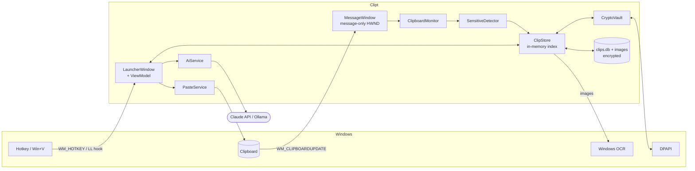
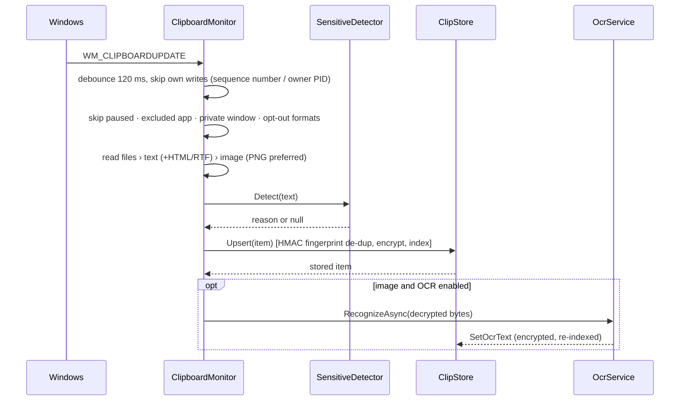
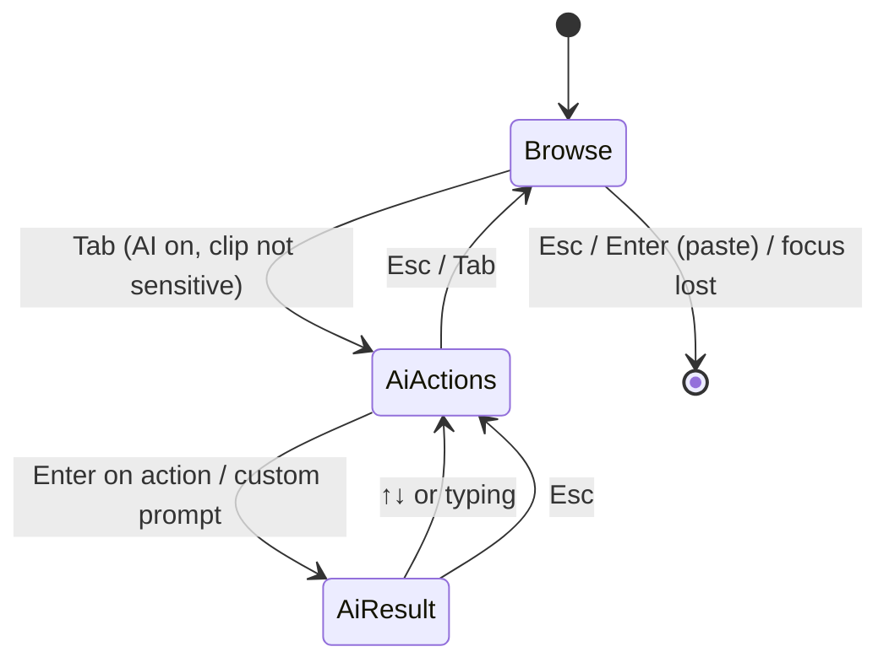

# Architecture

Clipt is a single-process WPF app (.NET 10, `net10.0-windows10.0.22621.0`). It uses Win32 interop for OS integration
and WinRT for OCR and the accent colour.

## Components

| Component | File | Responsibility |
|---|---|---|
| `App` | `App.xaml.cs` | Start-up, single instance, wiring, theme, retention timers, settings application |
| `MessageWindow` | `Native/MessageWindow.cs` | Hidden window that receives `WM_CLIPBOARDUPDATE` and `WM_HOTKEY` |
| `ClipboardMonitor` | `Services/ClipboardMonitor.cs` | Debounces updates; applies capture filters; reads formats; classifies; detects secrets |
| `SensitiveDetector` | `Services/SensitiveDetector.cs` | Recognises secrets (see [security.md](security.md#sensitive-content)) |
| `CryptoVault` | `Services/CryptoVault.cs` | DPAPI-wrapped master key, AES-GCM, HMAC fingerprints |
| `ClipStore` | `Services/ClipStore.cs` | Encrypted SQLite persistence, in-memory search index, retention, migration |
| `PasteService` | `Services/PasteService.cs` | Writes clips back to the clipboard, privacy flags, clipboard wipe, sends Ctrl+V |
| `HotkeyService` / `WinVHook` | `Services/HotkeyService.cs`, `Services/WinVHook.cs` | `RegisterHotKey`; optional low-level hook for Win+V |
| `OcrService` | `Services/OcrService.cs` | `Windows.Media.Ocr` over in-memory image bytes |
| `AiService` | `Services/AiService.cs` | Actions; Claude via the official `Anthropic` SDK (streaming); Ollama via HTTP |
| `AppCatalog` | `Services/AppCatalog.cs` | Friendly app list for exclusions (history, running processes, Start menu) |
| `LauncherWindow` / `LauncherViewModel` | `UI/` | The Spotlight-style UI and its state machine (Browse → AI actions → AI result) |
| `SettingsWindow`, `AppPickerWindow` | `UI/` | Preferences and the app picker |
| `WindowEffects` | `Native/WindowEffects.cs` | Acrylic/Mica backdrop, rounded corners, tool-window style, caption removal |

## Capture pipeline

## Storage

`clips.db` (SQLite, WAL, `secure_delete`, `user_version = 2`):

| Column | Stored as |
|---|---|
| `id`, `kind`, `image_w`, `image_h`, `created_at`, `last_used_at`, `use_count`, `pinned`, `sensitive` | plain integers |
| `text`, `html`, `rtf`, `ocr_text`, `source_app`, `source_path` | AES-GCM blobs (column name as associated data) |
| `fingerprint` | HMAC-SHA256 hex, `UNIQUE` |
| `image_path` | path to an encrypted `images/*.clip` file, named by keyed fingerprint |
| `sensitive_reason` | generic label, e.g. "Card number" |

At start-up, every row except HTML/RTF is decrypted into a `ClipItem` cache plus a normalised search string
(lower-case, diacritics removed, 200k characters max per clip). Sensitive clips are indexed by label only.
HTML/RTF are loaded on demand when pasting. Search filters the cache: AND of terms (substring match), `app:` filters, then
kind/pinned filters, ordered by last use.

A v0.1 `history.db` (plaintext + FTS5) is migrated on first start and then deleted with its PNG files.

## Launcher state machine

## Threading

Everything runs on the UI dispatcher except:
- OCR (WinRT async; one at a time behind a semaphore)
- the app catalog scan (`Task.Run`)
- AI streaming (`await foreach`; continuations return to the dispatcher)
- the low-level keyboard hook callback, which only checks the key and posts to the dispatcher

`ClipStore` serialises database and cache access with a lock.

## Windows integration details

- **Foreground handoff:** the window that was active when Clipt opened is remembered. On paste, Clipt restores it
  (`AttachThreadInput` + `SetForegroundWindow`), waits for modifier keys to be released, then sends Ctrl+V with `SendInput`.
- **Multi-monitor and DPI:** the launcher is moved to the target monitor first, then centred using its real pixel size
  after the per-monitor DPI change.
- **Backdrop:** `DWMWA_SYSTEMBACKDROP_TYPE` (acrylic for the launcher, mica for settings) on Windows 11 22H2+. A solid
  fallback is used on Windows 10.
- **List input:** rows are non-focusable so typing always reaches the search box. Mouse selection, wheel scrolling (rows
  per notch from the system setting, eased) and a minimum scrollbar thumb length are implemented explicitly.
